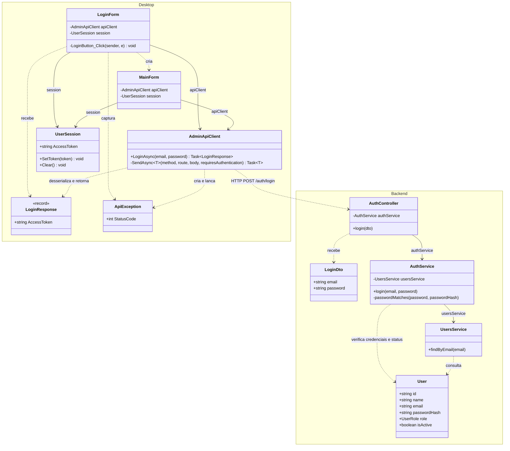
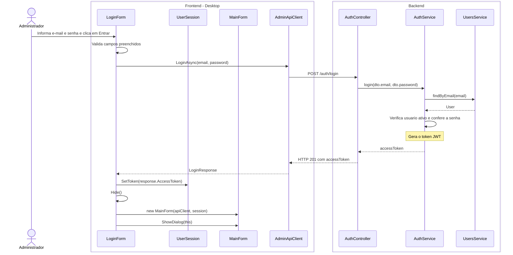

# 1. Fazer login

**Ator:** administrador.

Somente classes do projeto e o caminho feliz. O fluxo termina na abertura da
tela principal, sem detalhar inicializacao, estilizacao ou consulta de usuarios.

## Diagrama de classes

`LoginResponse` e um record do C#. `User` e a entidade do backend.
Linha continua indica associacao; linha tracejada indica dependencia.

## Diagrama de sequencia

Frontend a esquerda e backend a direita. Os DTOs e a entidade aparecem como
dados das mensagens. `ApiException` nao participa do caminho feliz.
Operacoes herdadas, como `Hide` e `ShowDialog`, sao indicadas sem adicionar
classes do framework.

**Regra atual:** o endpoint aceita qualquer usuario ativo com senha correta.
A permissao de administrador e exigida na consulta de usuarios da `MainForm`.

**Fontes:** `apps/desktop/src/EduQuest.Admin.Desktop/` e `apps/server/src/`,
especialmente `LoginForm.cs`, `Networking/AdminApiClient.cs`,
`auth/auth.controller.ts`, `auth/auth.service.ts` e `users/users.service.ts`.
