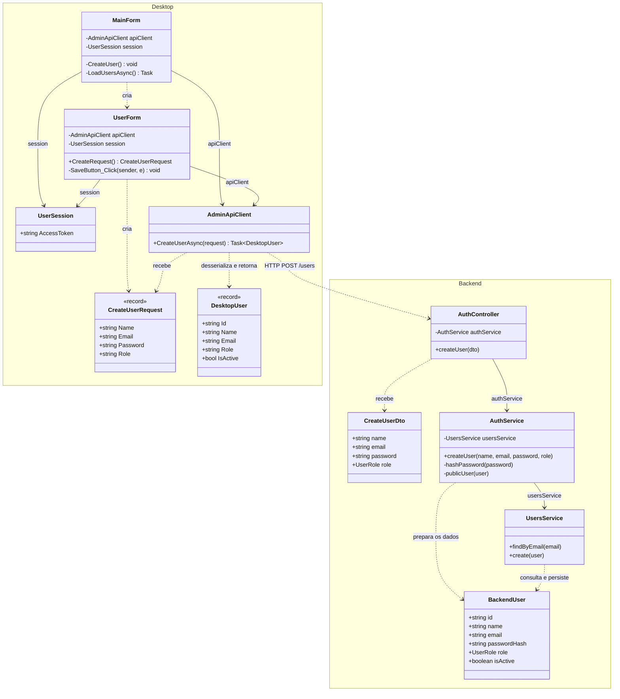
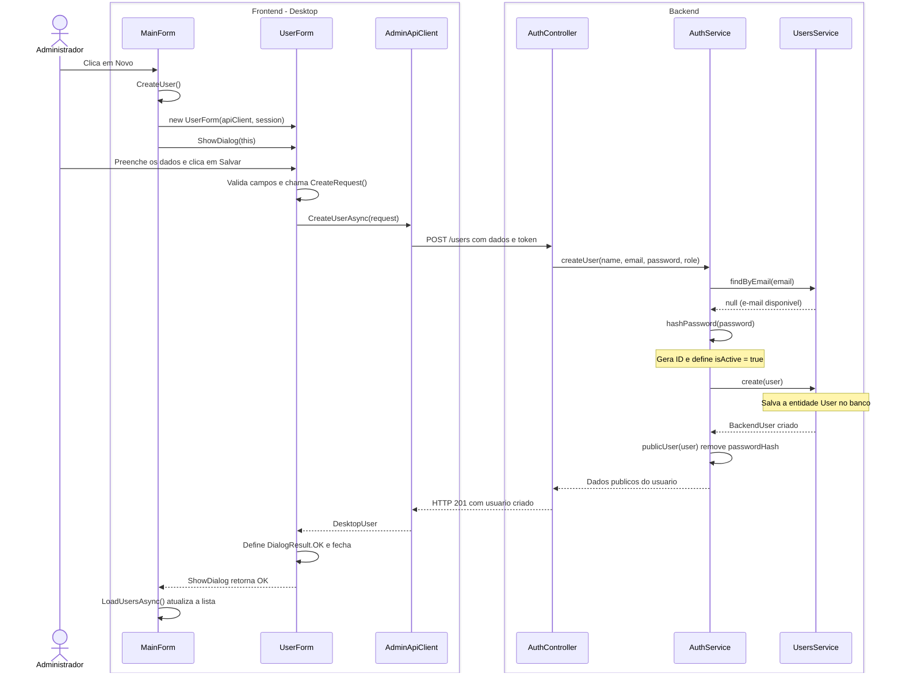

# 2. Incluir usuario

**Ator:** administrador.

**Precondicao:** administrador autenticado, com a tela principal aberta.

Somente classes do projeto e o caminho feliz. Login, autorizacao, estilizacao
e detalhes da atualizacao da lista ficam fora do fluxo.

## Diagrama de classes

`DesktopUser` e `BackendUser` identificam as classes `User` de cada aplicacao.
Sao tipos distintos, sem heranca entre eles.

## Diagrama de sequencia

Frontend a esquerda e backend a direita. Objetos de requisicao e usuarios
aparecem nos dados das mensagens. O cliente envia o token da sessao existente.

**Fontes:** `MainForm.cs`, `UserForm.cs`, `Models/CreateUserRequest.cs`,
`Models/User.cs` e `Networking/AdminApiClient.cs` no Desktop;
`auth/auth.controller.ts`, `auth/dto/create-user.dto.ts`, `auth/auth.service.ts`,
`users/users.service.ts` e `users/user.entity.ts` no backend.
