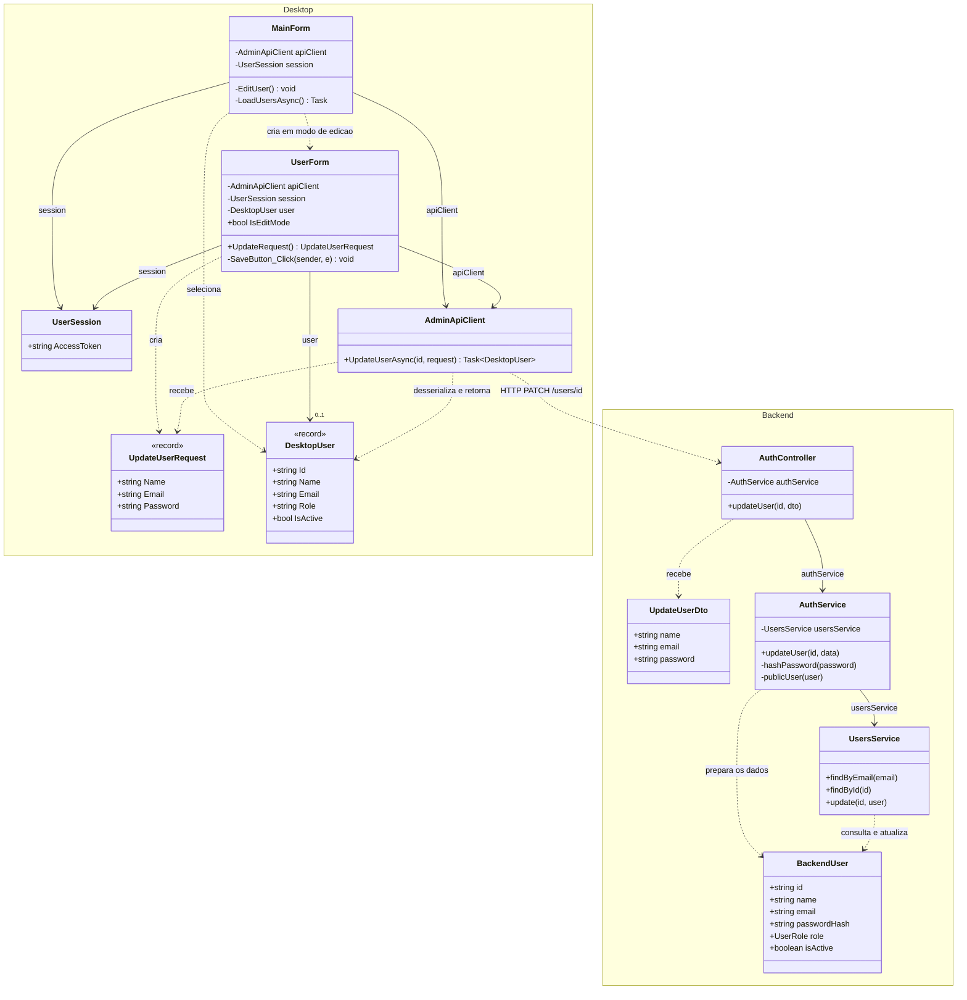
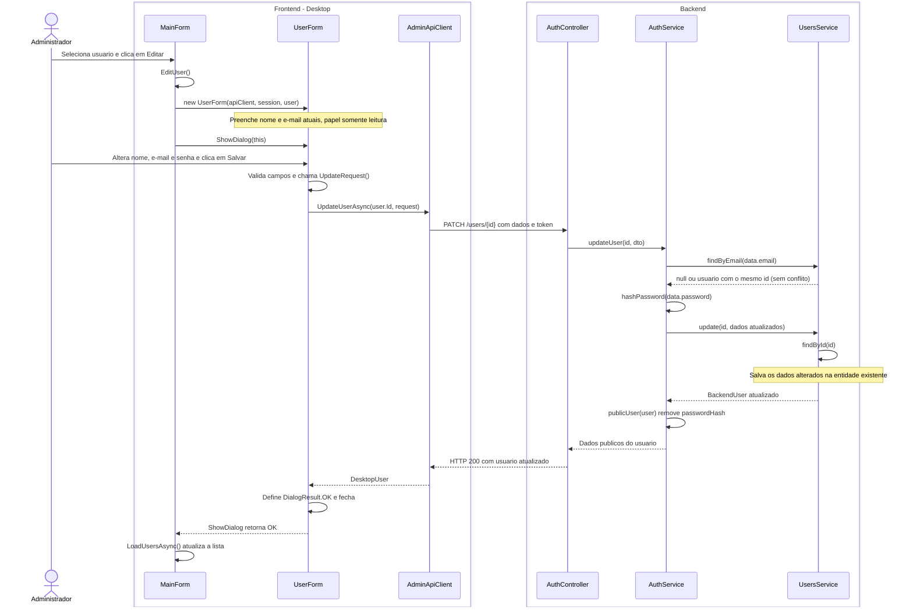

# 3. Editar usuario

**Ator:** administrador.

**Precondicao:** administrador autenticado, com a lista de usuarios carregada.

Somente classes do projeto e o caminho feliz. O papel nao pode ser alterado.
A senha e opcional: se ficar vazia, a atual e mantida. A sequencia considera
uma nova senha preenchida, sem detalhar login, autorizacao ou fluxos de erro.

## Diagrama de classes

`DesktopUser` e `BackendUser` representam as classes `User` de cada aplicacao.

## Diagrama de sequencia

Frontend a esquerda e backend a direita. Objetos de requisicao e usuarios
aparecem nos dados das mensagens, sem linhas de vida proprias.

**Fontes:** `MainForm.cs`, `UserForm.cs`, `Models/UpdateUserRequest.cs`,
`Models/User.cs` e `Networking/AdminApiClient.cs` no Desktop;
`auth/auth.controller.ts`, `auth/dto/update-user.dto.ts`, `auth/auth.service.ts`,
`users/users.service.ts` e `users/user.entity.ts` no backend.
