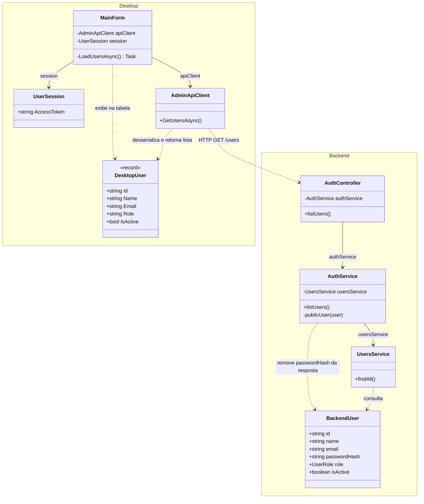
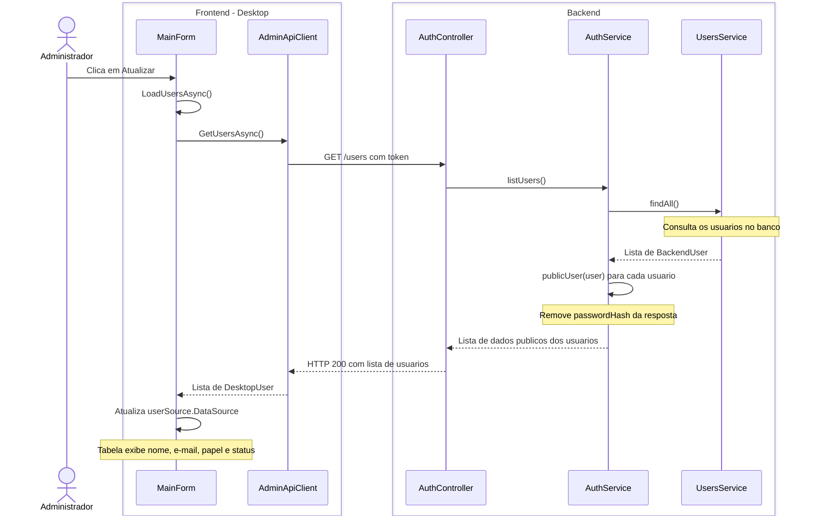

# 4. Listar usuarios

**Ator:** administrador.

**Precondicao:** administrador autenticado.

Somente classes do projeto e o caminho feliz. A lista e carregada ao abrir a
tela principal ou clicar em Atualizar. A sequencia considera o clique em
Atualizar, sem detalhar login, autorizacao ou fluxos de erro.

## Diagrama de classes

`DesktopUser` e `BackendUser` identificam as classes `User` de cada aplicacao.
Sao tipos distintos, sem heranca entre eles. Componentes visuais e classes de
bibliotecas nao sao representados.

## Diagrama de sequencia

Frontend a esquerda e backend a direita. Os usuarios aparecem nos dados das
mensagens, sem linhas de vida proprias. O cliente envia o token da sessao
existente.

**Regra atual:** a consulta retorna usuarios ativos e inativos, sem filtro ou
paginacao. A tabela apresenta o status como Ativo ou Inativo.

**Fontes:** `MainForm.cs`, `Models/User.cs`, `Session/UserSession.cs` e
`Networking/AdminApiClient.cs` no Desktop;
`auth/auth.controller.ts`, `auth/auth.service.ts`, `users/users.service.ts`
e `users/user.entity.ts` no backend.
