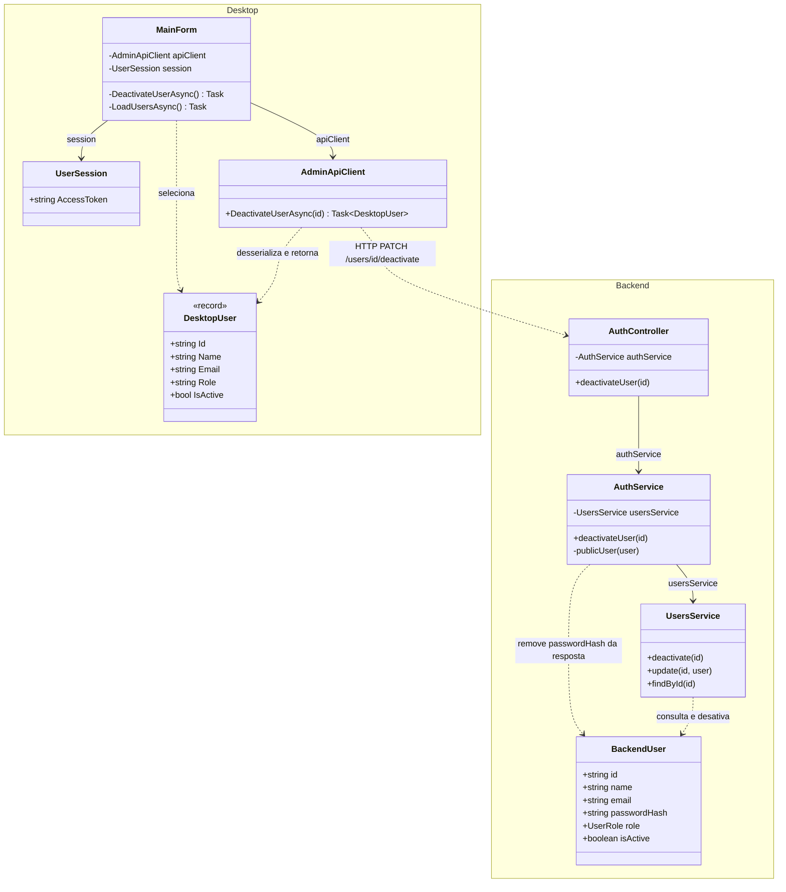
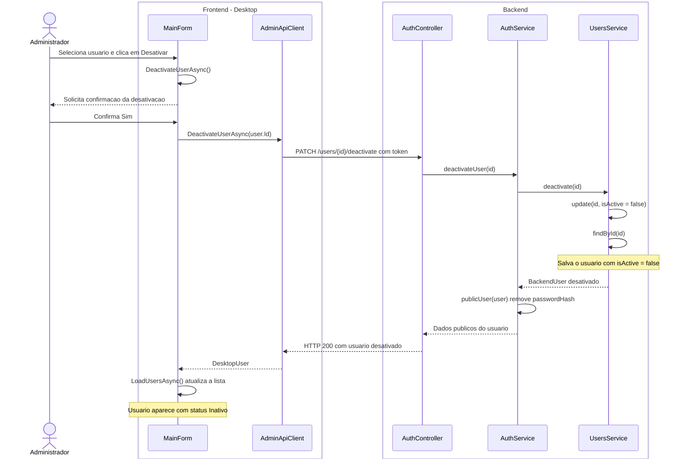

# 5. Desativar usuario

**Ator:** administrador.

**Precondicao:** administrador autenticado, com um usuario ativo selecionado
na lista.

Somente classes do projeto e o caminho feliz. O administrador confirma a acao,
o usuario e desativado e a lista e atualizada. Login, autorizacao e fluxos de
erro ficam fora do diagrama.

## Diagrama de classes

`DesktopUser` e `BackendUser` identificam as classes `User` de cada aplicacao.
Sao tipos distintos, sem heranca entre eles. A confirmacao e exibida pela
`MainForm`, sem representar componentes do framework.

## Diagrama de sequencia

Frontend a esquerda e backend a direita. Os usuarios aparecem como dados das
mensagens. O cliente envia o token da sessao existente. A atualizacao da lista
e indicada sem repetir o fluxo de Listar usuarios.

**Regra atual:** desativar altera `isActive` para `false`, sem excluir o registro.
O usuario continua na lista, mas nao pode fazer login.

**Fontes:** `MainForm.cs`, `Models/User.cs`, `Session/UserSession.cs` e
`Networking/AdminApiClient.cs` no Desktop;
`auth/auth.controller.ts`, `auth/auth.service.ts`, `users/users.service.ts`
e `users/user.entity.ts` no backend.
