# Diagrama de Classes do Desktop

Este diagrama representa as classes e os records da aplicação Windows Forms em `apps/desktop`. Associações contínuas representam referências mantidas pelas classes; dependências tracejadas representam criação, uso de tipos ou chamadas estáticas, não relações de banco de dados.

```mermaid
classDiagram
    class User {
        <<record>>
        +string Id
        +string Name
        +string Email
        +string Role
        +bool IsActive
    }

    class CreateUserRequest {
        <<record>>
        +string Name
        +string Email
        +string Password
        +string Role
    }

    class UpdateUserRequest {
        <<record>>
        +string Name
        +string Email
        +string Password
    }

    class LoginResponse {
        <<record>>
        +string AccessToken
    }

    class UserSession {
        <<session>>
        +string AccessToken
        +SetToken(token: string) void
        +Clear() void
    }

    class ApiSettings {
        <<static>>
        +string DefaultUrl
        +GetApiUrl()$ string
    }

    class AdminApiClient {
        <<client>>
        -JsonSerializerOptions JsonOptions
        -HttpClient httpClient
        -string baseUrl
        -Func~string~ accessTokenProvider
        +LoginAsync(email: string, password: string) Task~LoginResponse~
        +GetUsersAsync() Task~IReadOnlyList~User~~
        +CreateUserAsync(request: CreateUserRequest) Task~User~
        +UpdateUserAsync(id: string, request: UpdateUserRequest) Task~User~
        +DeactivateUserAsync(id: string) Task~User~
        -SendAsync~T~(method: HttpMethod, route: string, body: object, requiresAuthentication: bool) Task~T~
        -GetErrorMessage(content: string, statusCode: HttpStatusCode)$ string
    }

    class ApiException {
        <<exception>>
        +int StatusCode
    }

    class LoginForm {
        <<form>>
        -AdminApiClient apiClient
        -UserSession session
        -TextBox emailTextBox
        -TextBox passwordTextBox
        -Button loginButton
        -Label errorLabel
        -LoginButton_Click(sender: object, e: EventArgs) void
    }

    class MainForm {
        <<form>>
        -AdminApiClient apiClient
        -UserSession session
        -BindingSource userSource
        -DataGridView usersGrid
        -Button refreshButton
        -Button createButton
        -Button editButton
        -Button deactivateButton
        -Label errorLabel
        -IContainer components
        -InitializeComponent() void
        #Dispose(disposing: bool) void
        -ConfigureGrid() void
        -LoadUsersAsync() Task
        -CreateUser() void
        -EditUser() void
        -DeactivateUserAsync() Task
        -ExpireSession(showMessage: bool) void
        -SetBusy(busy: bool) void
    }

    class UserForm {
        <<form>>
        -AdminApiClient apiClient
        -UserSession session
        -User user
        -TextBox nameTextBox
        -TextBox emailTextBox
        -TextBox passwordTextBox
        -ComboBox roleComboBox
        -Label roleValueLabel
        -Label errorLabel
        -Button saveButton
        -Button cancelButton
        +bool IsEditMode
        +CreateRequest() CreateUserRequest
        +UpdateRequest() UpdateUserRequest
        -SaveButton_Click(sender: object, e: EventArgs) void
    }

    class UiTheme {
        <<static>>
        +Color Background
        +Color Primary
        +Color PrimaryHover
        +Color Accent
        +Color FieldBackground
        +Color Foreground
        +Color MutedForeground
        +Color Border
        +Color Error
        +CreateFont(size: float, style: FontStyle)$ Font
        +StyleForm(form: Form, useBackground: bool)$ void
        +StyleTextBox(textBox: TextBox)$ void
        +StyleComboBox(comboBox: ComboBox)$ void
        +StyleButton(button: Button, primary: bool)$ void
        +StyleGrid(grid: DataGridView)$ void
    }

    class Program {
        <<static>>
        -Main()$ void
    }

    Program ..> ApiSettings : Dependência - obtém URL da API
    Program ..> UserSession : Dependência - cria sessão
    Program ..> AdminApiClient : Dependência - cria cliente
    Program ..> LoginForm : Dependência - inicia formulário

    LoginForm --> AdminApiClient : Associação - mantém cliente
    LoginForm --> UserSession : Associação - mantém sessão
    LoginForm ..> LoginResponse : Dependência - lê token
    LoginForm ..> MainForm : Dependência - abre formulário
    LoginForm ..> ApiException : Dependência - trata exceção
    LoginForm ..> UiTheme : Dependência - aplica tema

    MainForm --> AdminApiClient : Associação - mantém cliente
    MainForm --> UserSession : Associação - mantém sessão
    MainForm ..> User : Dependência - lista e seleciona usuários
    MainForm ..> UserForm : Dependência - abre formulário
    MainForm ..> ApiException : Dependência - trata exceção
    MainForm ..> UiTheme : Dependência - aplica tema

    UserForm --> AdminApiClient : Associação - mantém cliente
    UserForm --> UserSession : Associação - mantém sessão
    UserForm --> "0..1" User : Associação - mantém usuário em edição
    UserForm ..> CreateUserRequest : Dependência - cria requisição
    UserForm ..> UpdateUserRequest : Dependência - cria requisição
    UserForm ..> ApiException : Dependência - trata exceção
    UserForm ..> UiTheme : Dependência - aplica tema

    AdminApiClient ..> LoginResponse : Dependência - desserializa resposta
    AdminApiClient ..> User : Dependência - desserializa usuário
    AdminApiClient ..> CreateUserRequest : Dependência - envia requisição
    AdminApiClient ..> UpdateUserRequest : Dependência - envia requisição
    AdminApiClient ..> ApiException : Dependência - lança exceção

    note for User "Role é string: admin, teacher ou student; não há enumeração no desktop"
    note for UserSession "Token mantido somente em memória; AccessToken possui atribuição privada"
    note for AdminApiClient "Recebe o token por callback configurado em Program; usa Bearer nas chamadas autenticadas"
    note for UserForm "Criação exige senha; edição preserva o papel e permite omitir a senha"
    note for ApiSettings "EDUQUEST_API_URL tem prioridade; padrão: http://localhost:3000"
```

## Relações

- **Associação (`-->`):** a classe de origem mantém uma referência ao objeto de destino em um atributo. As referências ao cliente HTTP e à sessão são compartilhadas, sem implicar propriedade exclusiva ou composição.
- **Dependência (`..>`):** a classe de origem usa o tipo de destino, por exemplo, ao criar objetos, chamar métodos estáticos, enviar requisições, ler respostas ou tratar exceções.
- **Multiplicidade `0..1`:** `UserForm` pode manter um usuário em edição ou nenhum usuário no modo de criação.
- Não são indicadas agregações ou composições entre os tipos da aplicação, pois as relações mostradas não estabelecem esses vínculos de propriedade. As heranças de tipos do .NET são omitidas conforme o escopo abaixo.

## Escopo

- Inclui os 13 tipos declarados no código de produção do desktop: nove classes e quatro records, representados como classes com o estereótipo `record`.
- Isso abrange modelos de resposta, requisições, cliente HTTP, exceção da API, sessão, configuração, formulários, tema visual e ponto de entrada.
- `MainForm.cs` e `MainForm.Designer.cs` declaram partes da mesma classe, representada uma única vez.
- Omite classes de testes, código gerado em `obj` e `bin`, membros sintetizados dos records e construtores, seguindo a estrutura resumida da UML do backend.
- Tipos e classes fornecidos pelo .NET, como `Form`, `Exception`, `HttpClient`, controles visuais e tipos de serialização, aparecem somente nas assinaturas e atributos. As heranças de `Form` e `Exception` não são desenhadas para não criar classes externas no diagrama.
- `User.Role` e `CreateUserRequest.Role` são strings, não enumerações. O desktop consome a API e não possui entidades de persistência próprias.
- `UpdateUserRequest.Name`, `Email` e `Password`, `UserSession.AccessToken`, `UserForm.user`, o callback `accessTokenProvider`, seu retorno, o corpo de `SendAsync` e o remetente dos eventos admitem `null`; essa nulabilidade e os valores padrão dos parâmetros foram omitidos nas assinaturas para simplificar a leitura.
- Os métodos marcados com `$` são estáticos. As cores de `UiTheme` e `AdminApiClient.JsonOptions` são campos `static readonly`; `ApiSettings.DefaultUrl` é uma constante. Propriedades dos records são inicializáveis, enquanto `IsEditMode` e `StatusCode` são somente leitura.
- Não há associação direta entre `AdminApiClient` e `UserSession`: `Program` fornece um callback que lê o token da sessão compartilhada pelos formulários.
- Respostas HTTP 401/403 em operações de usuários limpam a sessão e retornam à tela de acesso; os manipuladores de eventos de clique são `async void`, enquanto as operações HTTP retornam `Task`.
